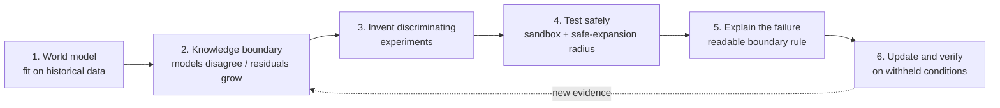
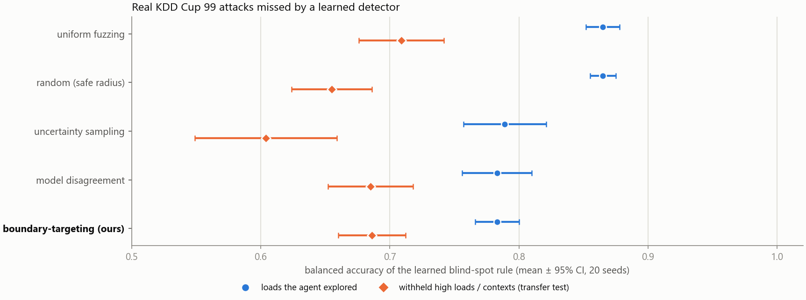
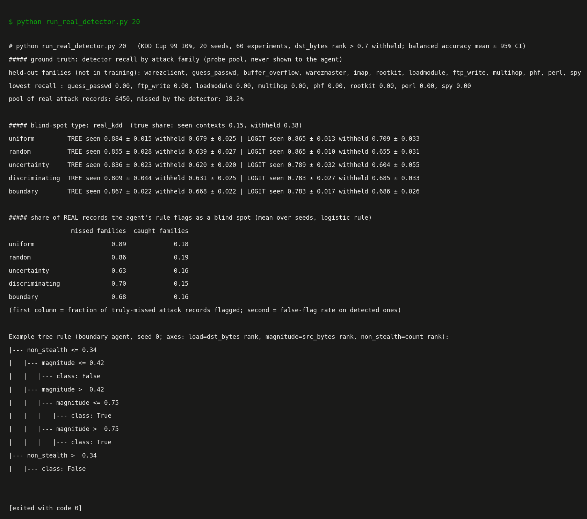

# Autonomous Boundary Discovery

**A benchmark and audit toolkit for finding where a detector goes blind, using only black-box experiments.**

Given a detector you can only query, where does it fail, which variable does it secretly depend on, and does that finding hold on conditions you never explored? This repo provides:

- **A benchmark** of four tasks with known ground truth: a power-grid bad-data detector (two blind-spot definitions), a learned detector with a planted training gap, and a learned detector on real KDD Cup 99 records. Strategies are scored on how well the blind-spot rule they learn from a fixed experiment budget predicts true failures, including on **withheld conditions**.
- **An audit pipeline** that returns a readable blind-spot rule, runs a paired-intervention shortcut test, and identifies a missing driver.
- **A reference method** (boundary-targeting experiment design) plus baselines, so any new strategy can be compared fairly. On the real dataset, simple space-filling baselines currently win (see the scorecard).

The testbed is **defensive and simulation-only**. A short write-up with the full scorecard and limitations is in the [technical report](docs/REPORT.md).

<p align="center">
  
</p>
<p align="center"><sub>One run, 60 experiments. Dashed line = true blind region (never shown to the agent). Shaded = the rule the agent has learned so far. Orange dots = experiments where the detector failed to respond.</sub></p>

> **Status: research prototype.** Everything below is computed by the code in this repo. Three of the four tasks are simulators I built or configured, so those results show what works *in those sandboxes*, not on real infrastructure. See [Limitations and prior art](#limitations-and-prior-art) before quoting any number.

### Scorecard (read this first)

Logistic-rule balanced accuracy, 20 seeds, mean ± 95% CI. "Boundary" is my reference method; **maximin** is a space-filling baseline (always probe the point farthest from everything tried), which turned out to be much stronger than uniform fuzzing.

| Task | Boundary | Uniform fuzzing | Maximin | Verdict for boundary-targeting |
|---|---|---|---|---|
| `grid_delta` (explored / withheld) | **0.993 ± 0.002** / **0.965 ± 0.014** | 0.885 / 0.829 | 0.964 ± 0.012 / 0.927 ± 0.041 | Better than both on explored; withheld overlaps maximin |
| `grid_adaptive` | 0.976 ± 0.009 / **0.975 ± 0.007** | 0.875 / 0.797 | 0.949 ± 0.025 / 0.895 ± 0.055 | Better on withheld; explored overlaps maximin |
| `ml_synthetic` (planted gap) | 0.864 ± 0.011 / 0.788 ± 0.050 | 0.856 / 0.692 | 0.872 ± 0.010 / 0.807 ± 0.075 | **No advantage** (maximin is as good) |
| **`kdd_real`** (real data) | 0.783 ± 0.017 / 0.686 ± 0.026 | 0.865 / 0.709 | 0.854 ± 0.009 / **0.774 ± 0.023** (no radius); 0.845 ± 0.014 / 0.681 ± 0.026 (same 0.2 radius as boundary) | **Worse**: uniform and maximin both beat it |
| **`unsw_real`** (newer real data) | 0.564 ± 0.025 / 0.551 ± 0.045 | 0.673 / 0.586 | 0.710 ± 0.027 / 0.613 ± 0.040 | **Worse, and nothing works**: every strategy is only 0.55 to 0.71 (0.5 = chance); the three-feature view cannot describe this detector's blind spots |

**Published-method baselines** (same protocol, logistic rule, explored / withheld; [raw output](results/benchmark_literature_baselines_results.txt)): `straddle` is active level-set estimation (Bryan et al. 2005; Gotovos et al. 2013) and `bo_falsify` is Bayesian-optimisation falsification, both on a Gaussian-process model of the distance to the blind-spot threshold.

| Task | Straddle | BO falsification | Boundary (mine) |
|---|---|---|---|
| `grid_delta` | 0.990 ± 0.008 / 0.963 ± 0.017 | 0.940 ± 0.025 / 0.927 ± 0.050 | 0.993 ± 0.002 / 0.965 ± 0.014 |
| `grid_adaptive` | 0.982 ± 0.007 / 0.881 ± 0.061 | 0.915 ± 0.025 / 0.954 ± 0.009 | 0.976 ± 0.009 / **0.975 ± 0.007** |
| `ml_synthetic` | 0.869 ± 0.016 / 0.758 ± 0.062 | 0.753 ± 0.040 / 0.643 ± 0.066 | 0.864 ± 0.011 / 0.788 ± 0.050 |
| `kdd_real` (radius 0.2) | **0.847 ± 0.009** / 0.672 ± 0.022 | 0.800 ± 0.024 / 0.629 ± 0.032 | 0.783 ± 0.017 / 0.686 ± 0.026 |

**Straddle is as good as my reference method on three of four tasks and clearly better on real explored conditions** (0.847 vs 0.783). My method keeps one clear edge: withheld conditions of `grid_adaptive` (0.975 vs 0.881 for straddle and 0.954 for BO falsification). BO falsification, which hunts for failures instead of mapping the boundary, is the weakest. So a published level-set method does at least as well as my boundary-targeting idea; the repo's value is the benchmark that makes this comparison possible.

**Missing-variable discovery** (simulated, planted driver): targeted design beats random (18/20 vs 11/20, p = 0.031 with confirmation) **and the space-filling baseline** (18/20 vs 8/20 with confirmation, Fisher p = 0.002). This is the strongest result in the repo, though the driver is one I planted. A second test on a learned detector **partially replicates** it: targeted design again beats the space-filling baseline (p ≈ 0.04) but not plain random sampling (p = 0.34), and no method works at weak drift (section 2b).

**Honest summary:** for blind-spot mapping, boundary-targeting helps on the two grid tasks I built, and the margin shrinks once the baseline is a proper space-filling design instead of uniform sampling. On the synthetic learned detector it adds nothing, and on the one real dataset it loses. The most promising result is targeted design for **missing-variable discovery**: it beat both baselines on the grid task, and on a second, learned-detector task it beat the space-filling baseline but not plain random sampling. This is why the repo is now framed as a benchmark and audit toolkit: the fair comparison is the contribution, and a method that wins it on real data has not been found yet. A published level-set baseline (`straddle`, below) matches or beats my method on three of the four tasks, so my reference method has a clear edge in only one setting (withheld conditions of `grid_adaptive`). Raw output: [results/benchmark_maximin_results.txt](results/benchmark_maximin_results.txt).

### Use the benchmark

```bash
python -m abd.benchmark --list
python -m abd.benchmark --task kdd_real --strategies uniform maximin boundary --seeds 10
python -m abd.benchmark --task grid_adaptive --strategies uniform boundary --seeds 20 --json out.json
```

Tasks: `grid_delta`, `grid_adaptive`, `ml_synthetic`, `kdd_real`, `unsw_real` (needs the UNSW-NB15 CSVs in `data/unsw/`, see `abd/unsw_detector_env.py`). Built-in strategies: `uniform`, `random`, `uncertainty`, `discriminating`, `boundary`, `hybrid`, `maximin`, `straddle` (level-set estimation), `bo_falsify` (BO falsification). Metric: balanced accuracy of the learned blind-spot rule on explored and on withheld conditions (mean ± 95% CI over seeds).

Add your own strategy in a few lines:

```python
from abd.blindspot import register_strategy
from abd.benchmark import run_task

def my_strategy(X, y, candidates, rng, labels):
    # X, y: experiments so far; candidates: allowed next experiments; labels(X, y) -> (impact, blind)
    return int(rng.integers(len(candidates)))          # return an index into candidates

register_strategy("mine", my_strategy)
run_task("kdd_real", ["uniform", "mine"], seeds=10)
```

---

## The idea in one picture



| Existing capability | What it does | This project |
|---|---|---|
| Anomaly detection | flags unusual observations | searches for the *conditions* where the model breaks |
| Active learning | picks informative examples | picks experiments that expose a *boundary* or a *missing variable* |
| Falsification | tests a hypothesis already written down | proposes the hypothesis (which variable? which region?) |

Whether this combination is new is a research question, not a claim. See [prior art](#limitations-and-prior-art).

## The sandbox: a grid detector with real blind spots

AC power flow ([pandapower](https://www.pandapower.org/), IEEE 14-bus) generates the "real" measurements. The defender's model is a linear **DC state estimator** with a residual-based bad-data test. The agent can only choose three things: the system **load**, the **magnitude** of a synthetic measurement perturbation, and how **non-stealthy** that perturbation is (0 = perfectly consistent with grid physics).

<p align="center"></p>

Two effects come straight from the physics, not from a planted rule:

1. **A physics-consistent perturbation is invisible at any size.** It lies in the estimator's column space, so the residual cannot change. (Covered by a unit test.)
2. **The detector's own model error grows with load.** The linear model drifts from AC reality, so its no-attack score climbs from about 1.8 to 16.5 across the load range. Operators typically respond by raising the alarm threshold at high load, which makes the blind region *grow* with load (right panel).

## Results

### 1. Mapping the blind spot (20 seeds, 60 experiments each)

The agent explores only loads up to 0.7 of the range. **Higher loads are withheld** and used to test whether the discovered rule transfers.

<p align="center"></p>

<details><summary>Raw output</summary>
<p align="center"></p>
</details>

What the numbers support, and what they don't:

- On the first blind-spot type, **boundary-targeting** (disagreement plus uncertainty near the estimated boundary) scores **0.965 ± 0.014** on the withheld loads with the logistic rule, versus **0.829 ± 0.086** for uniform fuzzing and **0.784 ± 0.090** for random exploration. Those intervals do not overlap.
- Against plain **model disagreement** (0.939 ± 0.029) the gap is smaller and the intervals overlap, so I would not claim boundary-targeting is clearly better than disagreement.
- Pure **uncertainty sampling** (a standard active-learning baseline) is not distinguishable from random exploration here.
- The blind region is a thin sliver (about 4% of impactful perturbations on the first type), and I designed the three-input parameterisation. A load-only withholding test is also an easy transfer case for the first blind-spot type, which is why the load-dependent second type exists.

The second blind-spot type (right panel) is **load-dependent**: it is the region below the alarm threshold operators would set at that load, so its share of impactful perturbations grows from 4% on explored loads to 7% on the withheld ones. This is the meaningful transfer test:

- Boundary-targeting with the logistic rule scores **0.975 ± 0.007** on withheld loads, versus 0.911 ± 0.037 for model disagreement, 0.891 ± 0.081 for uncertainty sampling, 0.808 ± 0.088 for random and 0.797 ± 0.088 for uniform fuzzing. Its interval is clearly separate from disagreement, random and uniform; against uncertainty sampling the intervals nearly touch, so I would call that one suggestive rather than settled.
- The **decision-tree rule does not transfer** (boundary-targeting: 0.937 on explored loads, 0.825 on withheld). Axis-aligned splits cannot extrapolate a boundary that moves with load. The logistic rule with interaction features can, which is why both are reported.
- Both rule types are trained on the agent's own labels; it never sees the ground-truth blind region.

### 2. Discovering a variable the model does not have

A hidden driver (ambient temperature) heats only part of the network and stretches line reactance. The defender's model has no such input. The agent can read three context channels, only one of which is real:

<p align="center"></p>

Left: random experiment conditions. Right: conditions chosen where the fitted model says the hidden driver matters most (high load). Targeted design separates the real channel from the two distractors much sooner.

<p align="center"></p>

| Strategy | Real driver found | Wrong channel named | Experiments (median) |
|---|---|---|---|
| random | 12 / 20 | 2 | 105 |
| targeted | 18 / 20 | 2 | **75** |
| random + confirm | 11 / 20 | 0 | 200 (cap) |
| **targeted + confirm** | **18 / 20** | **0** | 160 |
| maximin (space-filling) | 9 / 20 | 1 | 180 |
| maximin + confirm | 8 / 20 | 0 | 200 (cap) |

- Targeted vs random (with confirmation): **18/20 vs 11/20, Fisher exact p = 0.031.** Against the stronger space-filling (maximin) baseline the gap is larger: **18/20 vs 8/20, p = 0.002** ([saved output](results/missing_variable_maximin_results.txt)). Without confirmation the gap is 18/20 vs 12/20, p = 0.065, borderline.
- The **confirmation step** (30 fresh high-load experiments, test only the flagged channel, out of sample) removed both false identifications, but 0 vs 2 out of 20 is not statistically significant (p = 0.49), and it roughly doubles the cost.
- The hidden driver is one I planted, so this shows the method works on a planted missing variable. It does not show it can find an unknown one.

<details><summary>Raw output</summary>
<p align="center"></p>
</details>

### 2b. Second missing-variable test: a learned detector (partial replication)

One planted driver on one simulator is thin evidence, so I repeated the missing-variable task on the learned detector from section 3: a hidden traffic-mix variable shifts the feature vector, the detector never saw it, and the agent can read one noisy proxy plus two distractors ([abd/ml_ctx_env.py](abd/ml_ctx_env.py)). I fixed two drift strengths **in advance** (2.5 = hard, 4.0 = easier) and report both. 20 seeds, cap of 200 experiments ([saved output](results/missing_variable_ml_results.txt)).

| Real driver found (of 20) | drift 2.5 (hard) | drift 4.0 (easier) | wrong channel named, drift 4.0 |
|---|---|---|---|
| random | 4 | 16 | 3 |
| **targeted** | 5 | **19** | **0** |
| maximin (space-filling) | 4 | 13 | 1 |
| random + confirm | 1 | 6 | 0 |
| targeted + confirm | 1 | 11 | 0 |
| maximin + confirm | 0 | 4 | 0 |

What holds and what doesn't:
- **At the easier drift, targeted design is best on every row**, and it beats the space-filling baseline (19 vs 13, p = 0.044; with confirmation 11 vs 4, p = 0.048). It is **not** significantly better than random (19 vs 16, p = 0.34; with confirmation 11 vs 6, p = 0.20).
- **At the hard drift no method works** (4 to 5 of 20 without confirmation, about 1 with it), so there is nothing to compare.
- So the grid result **partially replicates**: targeted design again beats the space-filling baseline, but its advantage over plain random sampling is not established here.
- Confirmation again removes false identifications but costs a lot of power on this task (it spends 30 experiments per attempt against a cap of 200).

Protocol notes, because they differ from the grid task: the x-only model is a random forest with out-of-bag residuals, targeted design uses a random-forest sensitivity estimate, and confirmation follows each strategy's own design policy. My first targeted design and confirmation step (quadratic model, high-load sampling) failed on this task because they assumed the grid's structure; I rebuilt them once, then ran the full pre-planned comparison. The grid task keeps its original protocol and its saved results are unchanged.

### 3. Contribution to AI security: auditing a *learned* detector

The grid detector is hand-built maths. Most deployed detectors are **learned**, and they fail differently: their blind spots come from gaps in the training data and from shortcut features. This testbed applies the same engine to a gradient-boosted classifier trained on **synthetic** traffic-like feature vectors (no real malware, attack data or prompt text anywhere in the repo).

In training, attacks were only ever recorded at low *context* (think network load or time of day) and with clearly visible signatures. Context never defines an attack, so any dependence on it is a shortcut.

<p align="center"></p>

The detector's blind spot follows its **training gap**, not the attack: a strong, fully visible attack is caught up to about 0.6 context and missed beyond about 0.7. The agent may only explore contexts up to 0.7; everything above is withheld (98% of it is a true blind spot, so that test is mostly "does the rule extrapolate to a region it never saw").

<p align="center"></p>

**Blind-spot map (20 seeds, logistic rule, withheld contexts):** boundary-targeting **0.788 ± 0.050**, uncertainty sampling 0.718 ± 0.053, uniform fuzzing 0.692 ± 0.086, model disagreement 0.678 ± 0.053, random 0.653 ± 0.066. Boundary-targeting is best, but this is a smaller and noisier win than on the grid: its interval overlaps uncertainty sampling, so treat it as suggestive. On the contexts the agent did explore, all methods are close (0.79 to 0.86).

**Shortcut test (paired intervention):** hold a strong visible attack fixed and change *only* the context from low (0.1 to 0.4) to high (0.85 to 1.0). The detector's score on the attack drops by **0.73** (Wilcoxon p = 1.6e-11, n = 60), while its score on benign traffic moves by 0.12 (also significant, p = 6e-11, but about six times smaller). A detector that did not depend on context would show no change, so this flags context as a variable the model should not use.

<details><summary>Raw output</summary>
<p align="center"></p>
</details>

**Why this matters, and what it does not show**
- It demonstrates the engine as an *audit tool for learned detectors*: it returns a readable map of where the detector fails and which non-causal variable it leans on, with evidence, using only black-box queries.
- The training gap and the shortcut are planted by me. This shows the engine can find a known kind of flaw in a learned detector, not that it will find unknown flaws in a deployed one.
- The tree rules in the saved output call the context knob `load` because the engine reuses the grid sandbox's input layout.
- Next steps for credibility: real public intrusion-detection datasets, several model families, and comparison with robustness-testing tools.

### 4. Real data: a learned detector on KDD Cup 99 (a negative result)

Nothing is planted here. A gradient-boosted detector is trained on the public [KDD Cup 99](https://archive.ics.uci.edu/dataset/130/kdd+cup+1999+data) (10%) records using normal traffic plus the common attack families; twelve rare remote-to-local and user-to-root families are held out of training. The agent probes the detector with **real attack records**: a query is a point in a 3-feature rank space (destination bytes, source bytes, connection count), snapped to the nearest real record. Ground truth for scoring is the detector's actual decision on that record.

The detector has a natural gap: recall is 0.00 on `guess_passwd`, `ftp_write`, `loadmodule`, `multihop`, `phf`, `rootkit`, `perl` and `spy`, and it misses 18.2% of the 6,450-record probe pool. Destination-bytes ranks above 0.7 are withheld from exploration.

<p align="center"></p>

**Result: on real data, boundary-targeting does not win.** With the logistic rule, plain **uniform fuzzing is best** (0.865 ± 0.013 explored, 0.709 ± 0.033 withheld). Boundary-targeting scores 0.783 ± 0.017 and 0.686 ± 0.026; the two intervals do not overlap on the explored contexts, and overlap on the withheld ones. Random exploration with the safe-expansion radius (0.865 / 0.655) is also at or above the three model-based strategies on explored contexts.

**Ablation: is the safe-expansion radius to blame?** I suspected so, because uniform fuzzing is the only strategy that ignores it, and on an offline dataset the radius protects nothing. So I re-ran the three model-based strategies with no radius (same data, same 20 seeds; [saved output](results/real_detector_noradius_results.txt)):

| Strategy (logistic rule) | Explored, with radius | Explored, no radius | Withheld, with radius | Withheld, no radius |
|---|---|---|---|---|
| Boundary-targeting | 0.783 ± 0.017 | 0.760 ± 0.030 | 0.686 ± 0.026 | 0.681 ± 0.040 |
| Model disagreement | 0.783 ± 0.027 | 0.770 ± 0.031 | 0.685 ± 0.033 | 0.727 ± 0.040 |
| Uncertainty sampling | 0.789 ± 0.032 | 0.765 ± 0.018 | 0.604 ± 0.055 | 0.647 ± 0.052 |
| *Uniform fuzzing (reference)* | *0.865 ± 0.013* | | *0.709 ± 0.033* | |

**The radius hypothesis is not supported.** Boundary-targeting does not improve without it (0.760 / 0.681), and on explored contexts all three stay well below uniform fuzzing (0.865). Only model disagreement gained a little on withheld contexts (0.727), which overlaps uniform's interval, so it is not a clear win either. On this dataset the loss belongs to the model-based strategies themselves.

**Hybrid test (coverage first, then targeting).** If coverage is what matters, spending the first half of the budget on uniform sampling and the second half on boundary-targeting should recover the gap ([saved output](results/real_detector_hybrid_results.txt), same seeds):

| Strategy (logistic rule) | Explored | Withheld |
|---|---|---|
| Uniform fuzzing | 0.865 ± 0.013 | 0.709 ± 0.033 |
| **Hybrid** | 0.807 ± 0.021 | 0.702 ± 0.035 |
| Boundary-targeting | 0.783 ± 0.017 | 0.686 ± 0.026 |

The hybrid sits between the two on explored contexts, but its interval overlaps boundary-targeting's and is clearly below uniform's. On withheld contexts it matches uniform. So adding coverage helps a little but **does not close the gap**: on this dataset none of the targeted strategies I tried beats uniform fuzzing.

**Larger budget (200 experiments instead of 60).** Maybe targeting only pays off once there is more data to learn from ([saved output](results/real_detector_budget200_results.txt), no radius, same seeds):

| Strategy (logistic rule) | Explored | Withheld |
|---|---|---|
| Uniform fuzzing | 0.868 ± 0.008 | 0.728 ± 0.031 |
| Hybrid | 0.810 ± 0.007 | 0.695 ± 0.014 |
| Boundary-targeting | 0.772 ± 0.009 | 0.718 ± 0.030 |

It does not. Boundary-targeting at 200 experiments (0.772) is no better than at 60 (0.783), and uniform fuzzing is still clearly ahead on explored contexts. On withheld contexts the three are within each other's intervals. So more budget does not change the real-data verdict.

Remaining explanations are untested hypotheses:
- **Coverage may still matter**, but not by itself: real blind spots here are clusters of rare families scattered through the feature space, and at 60 experiments even half a budget of targeting seems to cost more than it gains.
- **The 3-feature rank projection is a coarse view** of what separates those families, so a boundary in that space is a weak target.
- **Withheld contexts are hard for every method**: all strategies land between about 0.60 and 0.73.

On the agent's rule over the real records, uniform flags 89% of the truly missed records (and 18% of the detected ones); boundary-targeting flags 68% (and 16%). So on this dataset the model-based strategies are more conservative, not more accurate.

<details><summary>Raw output</summary>
<p align="center"></p>
</details>

**What this does and does not change.** It shows the audit pipeline runs end to end on real labelled data and recovers a large share of a real detector's blind spots. It also shows the advantage I measured in simulation does **not** carry over, so the simulator results should not be read as evidence that targeted exploration beats fuzzing in general. KDD Cup 99 is old and has known redundancy, so the next check is a newer dataset (CICIoT2023 is the candidate).

### How the agent works

| Step | Implementation |
|---|---|
| World model | ridge polynomial baseline fit on narrow historical data ([abd/agent.py](abd/agent.py)) |
| Competing explanations | committee of poly-1/2/3, random forest and Gaussian process; spread = knowledge boundary |
| Safe experiments | candidates restricted to a radius around already-tested points, plus a conservative predicted-output filter |
| Boundary extraction | shallow decision tree (readable rules) and a logistic rule with interaction features (extrapolates to unseen loads) |
| Blind-spot label | agent learns its own "no perturbation" reference from calibration runs, so it never needs ground truth ([abd/blindspot.py](abd/blindspot.py)) |
| Missing variable | residual of the x-only model vs candidate context channels, Bonferroni-corrected, then out-of-sample confirmation ([run_missing.py](run_missing.py)) |

Example rule found by the agent on one run (readable, not a black box):

```
non_stealth <= 0.06
|  magnitude <= 0.53              -> blind
|  magnitude  > 0.53
|     non_stealth <= 0.03         -> blind
|     non_stealth  > 0.03         -> detector responds
non_stealth > 0.06                -> detector responds
```

## Quickstart

```bash
git clone https://github.com/ara-5/Autonomous-Boundary-Discovery.git
cd Autonomous-Boundary-Discovery
pip install -r requirements.txt

python -m pytest -q                 # 3 smoke tests (~30 s)
python run_demo.py                  # stage 0: toy hidden-regime environment
python run_grid.py                  # stage 1: grid detector, prediction error
python run_blind.py 20              # stage 2: blind-spot map + withheld-load transfer (slow)
python run_missing.py 20            # stage 3: missing-variable discovery (grid)
python run_missing.py 20 --env ml --drift 4.0   # same task on a learned detector (partial replication)
python run_ml_detector.py 20        # stage 4: audit a learned (ML) detector + shortcut test
python run_real_detector.py 20      # stage 5: real KDD Cup 99 data (downloads ~2 MB via scikit-learn)
python -m abd.benchmark --list      # the packaged benchmark (see above)
python scripts/make_media.py        # regenerate the GIFs and heatmap (needs PYTHONPATH=.)
python scripts/make_results.py      # regenerate the charts from results/*.txt
```

Verbatim outputs of the long runs are saved in [results/](results/).

## Repository layout

```
abd/
  env.py            toy environment with a planted hidden regime
  agent.py          committee world model, safe discriminating experiments, boundary + update
  grid_env.py       IEEE-14 grid + DC state estimator + bad-data detector
  grid_ctx_env.py   same, plus a hidden temperature driver and context channels
  blindspot.py      blind-spot agent, load withholding, adaptive-threshold labels
  benchmark.py      benchmark CLI: tasks, scoring, plug-in strategies
  ml_ctx_env.py     learned detector plus a hidden traffic-mix driver (second missing-variable task)
  ml_detector_env.py  learned (gradient-boosted) detector on synthetic traffic with a training gap
  real_detector_env.py  same audit on real KDD Cup 99 records (held-out attack families)
run_demo.py  run_grid.py  run_blind.py  run_missing.py  run_ml_detector.py  run_real_detector.py
scripts/            make_media.py (GIFs, heatmap), make_results.py (charts)
results/            saved outputs of the 20-seed runs
tests/              smoke tests
```

## Limitations and prior art

I would rather state these up front than have them found.

**Limitations**
- Simulators only. The environments, the three-input parameterisation and the planted temperature driver are my construction.
- The agent's rule is imperfect: in the animation it underfits the diagonal tail of the true blind region.
- 20 seeds per cell; several differences have overlapping intervals (flagged above).
- The blind-spot definition (distinguishable by a margin, or below an adaptive threshold) is a modelling choice.
- Confirmation roughly doubles experiment cost; a cheaper sequential test is untested.

**Prior art this builds on or must be compared with** (from a first-pass search; I read snippets, not full papers, so treat as a reading list):
- Falsification of cyber-physical systems with Bayesian optimisation: [Ramezani et al.](https://research.chalmers.se/publication/546723)
- Safe Bayesian optimisation and safe-region classification: [SafeOpt-MC](https://arxiv.org/pdf/1602.04450), [GoSafe](https://arxiv.org/pdf/2105.13281.pdf), [Bottero et al.](https://pdf.arxiv.org/pdf/2402.15347)
- Hidden variables with active experiments: [LLM-AutoSciLab](https://huggingface.co/papers/2605.24043.md), [Model Discovery Agent](https://tldr.takara.ai/p/2608.09696)
- Learning-based detectors for stealthy false-data injection: [autoencoder detection](https://minds.wisc.edu/items/ef0b32bd-1840-4630-b443-b87891ca6e39), [deep learning on DER-rich grids](https://research.itu.edu.tr/en/publications/deep-neural-network-based-stealthy-false-data-injection-attack-de/)

Hidden-variable discovery with active experiments is already being pursued in general settings, so I am **not** claiming it as new. The open question this repo explores is the *combination*: boundary mapping plus missing-variable identification, under a safety constraint, verified on withheld conditions, applied to where a deployed defensive detector's model breaks.

## Roadmap

- Cheaper, sequential confirmation for the missing-variable step
- Level-set estimation and BO falsification are now baselines (simple GP versions of my own); next: the authors' implementations and safe-exploration methods with formal guarantees
- A newer real dataset (CICIoT2023) and several model families, to see whether uniform fuzzing's advantage on real data is specific to KDD Cup 99
- Other feature projections of the real data (neither a hybrid nor a larger budget helped boundary-targeting)
- Environments I did not design (larger grids, other domains)
- Explicit hypothesis-based experiment selection (expected information gain) instead of committee disagreement
- A benchmark of procedurally generated hidden-rule environments

## License

Released under the [MIT License](LICENSE).

## Responsible use

This is a **defensive, simulation-only** project. The "perturbations" are synthetic measurement shifts inside a sandbox, used to find where a detector's model is unreliable so it can be hardened. It contains no tooling for real systems and none should be added.
