# Autonomous Boundary Discovery

**An agent that discovers where its own understanding of a system stops being true.**

Most failure-finding tools search the inputs a model already has. This project asks a harder question: *given a system whose rules I was never told, where does my current model stop predicting reality, which variable am I missing, and what is the safest experiment that would show it?*

The testbed is **defensive and cyber-physical**: a simulated IEEE 14-bus power grid protected by a classic bad-data detector. The agent learns where that detector goes blind, without ever being told the rule.

<p align="center">
  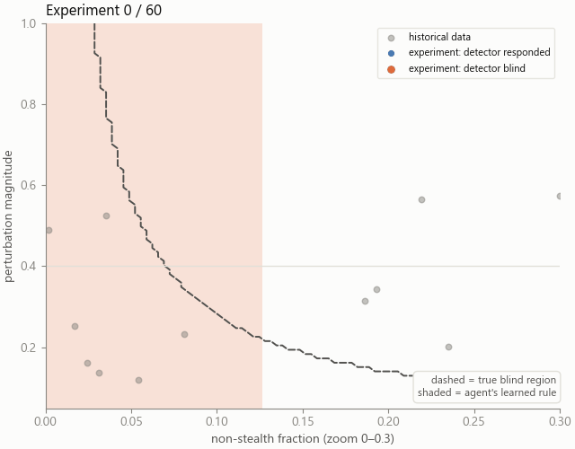
</p>
<p align="center"><sub>One run, 60 experiments. Dashed line = true blind region (never shown to the agent). Shaded = the rule the agent has learned so far. Orange dots = experiments where the detector failed to respond.</sub></p>

> **Status: research prototype.** Everything below is computed by the code in this repo, on simulators I built or configured, so the results show the method works *in these sandboxes*. They are not evidence it works on real infrastructure. See [Limitations and prior art](#limitations-and-prior-art) before quoting any number.

---

## The idea in one picture

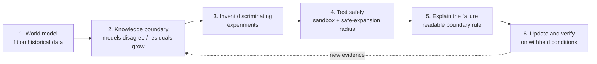

| Existing capability | What it does | This project |
|---|---|---|
| Anomaly detection | flags unusual observations | searches for the *conditions* where the model breaks |
| Active learning | picks informative examples | picks experiments that expose a *boundary* or a *missing variable* |
| Falsification | tests a hypothesis already written down | proposes the hypothesis (which variable? which region?) |

Whether this combination is new is a research question, not a claim. See [prior art](#limitations-and-prior-art).

## The sandbox: a grid detector with real blind spots

AC power flow ([pandapower](https://www.pandapower.org/), IEEE 14-bus) generates the "real" measurements. The defender's model is a linear **DC state estimator** with a residual-based bad-data test. The agent can only choose three things: the system **load**, the **magnitude** of a synthetic measurement perturbation, and how **non-stealthy** that perturbation is (0 = perfectly consistent with grid physics).

<p align="center">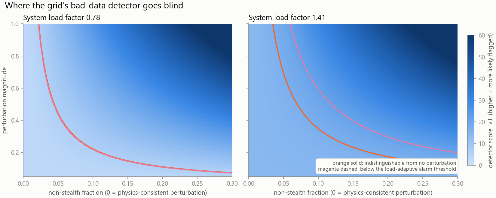</p>

Two effects come straight from the physics, not from a planted rule:

1. **A physics-consistent perturbation is invisible at any size.** It lies in the estimator's column space, so the residual cannot change. (Covered by a unit test.)
2. **The detector's own model error grows with load.** The linear model drifts from AC reality, so its no-attack score climbs from about 1.8 to 16.5 across the load range. Operators typically respond by raising the alarm threshold at high load, which makes the blind region *grow* with load (right panel).

## Results

### 1. Mapping the blind spot (20 seeds, 60 experiments each)

The agent explores only loads up to 0.7 of the range. **Higher loads are withheld** and used to test whether the discovered rule transfers.

<p align="center">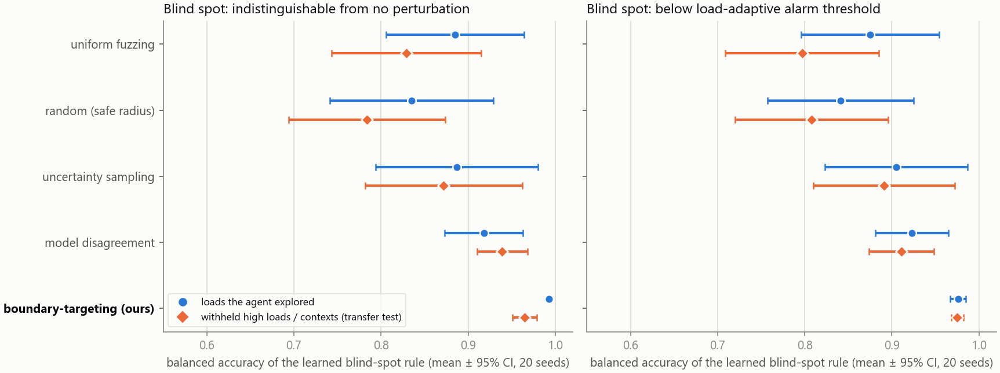</p>

<details><summary>Raw output</summary>
<p align="center">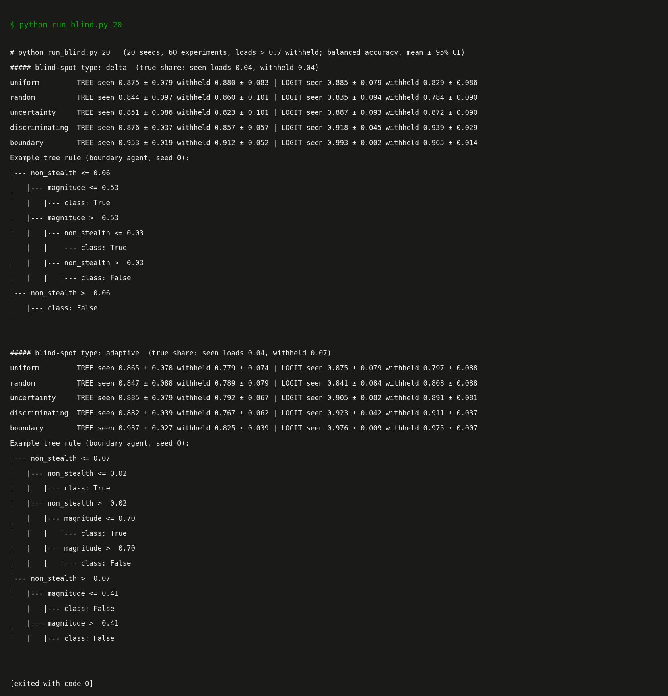</p>
</details>

What the numbers support, and what they don't:

- On the first blind-spot type, **boundary-targeting** (disagreement plus uncertainty near the estimated boundary) scores **0.965 ± 0.014** on the withheld loads with the logistic rule, versus **0.829 ± 0.086** for uniform fuzzing and **0.784 ± 0.090** for random exploration. Those intervals do not overlap.
- Against plain **model disagreement** (0.939 ± 0.029) the gap is smaller and the intervals overlap, so I would not claim boundary-targeting is clearly better than disagreement.
- Pure **uncertainty sampling** (a standard active-learning baseline) is not distinguishable from random exploration here.
- The blind region is a thin sliver (about 4% of impactful perturbations on the first type), and I designed the three-input parameterisation. A load-only withholding test is also an easy transfer case for the first blind-spot type, which is why the load-dependent second type exists.

The second blind-spot type (right panel) is **load-dependent**: it is the region below the alarm threshold operators would set at that load, so its share of impactful perturbations grows from 4% on explored loads to 7% on the withheld ones. This is the meaningful transfer test:

- Boundary-targeting with the logistic rule scores **0.975 ± 0.007** on withheld loads, versus 0.911 ± 0.037 for model disagreement, 0.891 ± 0.081 for uncertainty sampling, 0.808 ± 0.088 for random and 0.797 ± 0.088 for uniform fuzzing. Its interval is clearly separate from disagreement, random and uniform; against uncertainty sampling the intervals nearly touch, so I would call that one suggestive rather than settled.
- The **decision-tree rule does not transfer** (boundary-targeting: 0.937 on explored loads, 0.825 on withheld). Axis-aligned splits cannot extrapolate a boundary that moves with load. The logistic rule with interaction features can, which is why both are reported.
- Both rule types are trained on the agent's own labels; it never sees the ground-truth blind region.

### 2. Discovering a variable the model does not have

A hidden driver (ambient temperature) heats only part of the network and stretches line reactance. The defender's model has no such input. The agent can read three context channels, only one of which is real:

<p align="center">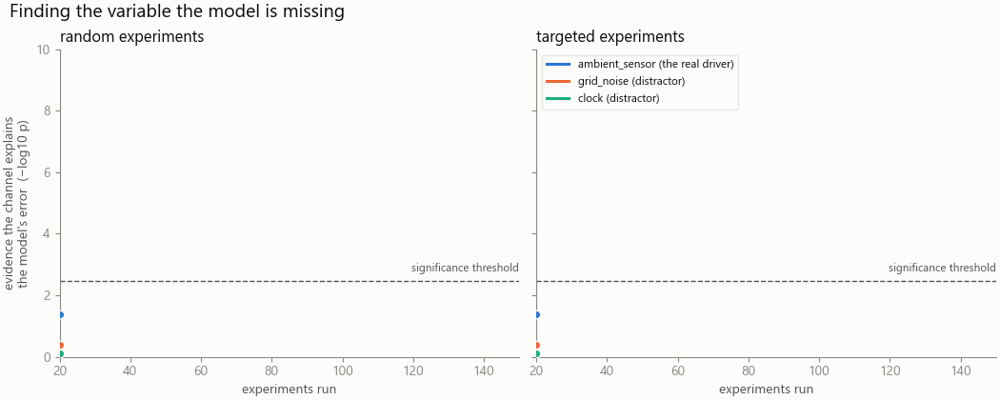</p>

Left: random experiment conditions. Right: conditions chosen where the fitted model says the hidden driver matters most (high load). Targeted design separates the real channel from the two distractors much sooner.

<p align="center">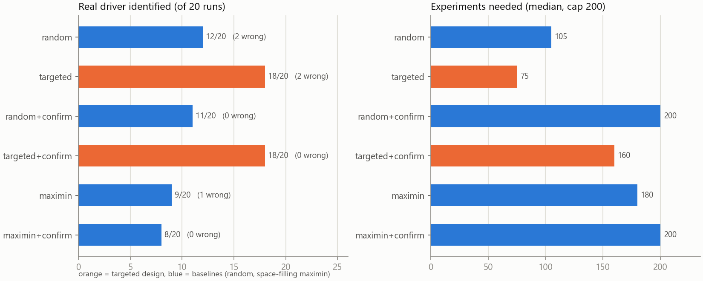</p>

| Strategy | Real driver found | Wrong channel named | Experiments (median) |
|---|---|---|---|
| random | 12 / 20 | 2 | 105 |
| targeted | 18 / 20 | 2 | **75** |
| random + confirm | 11 / 20 | 0 | 200 (cap) |
| **targeted + confirm** | **18 / 20** | **0** | 160 |

- Targeted vs random (with confirmation): **18/20 vs 11/20, Fisher exact p = 0.031.** Without confirmation the gap is 18/20 vs 12/20, p = 0.065, borderline.
- The **confirmation step** (30 fresh high-load experiments, test only the flagged channel, out of sample) removed both false identifications, but 0 vs 2 out of 20 is not statistically significant (p = 0.49), and it roughly doubles the cost.
- The hidden driver is one I planted, so this shows the method works on a planted missing variable. It does not show it can find an unknown one.

<details><summary>Raw output</summary>
<p align="center">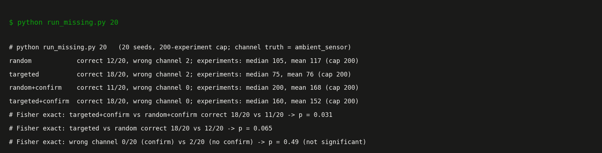</p>
</details>

### 3. Contribution to AI security: auditing a *learned* detector

The grid detector is hand-built maths. Most deployed detectors are **learned**, and they fail differently: their blind spots come from gaps in the training data and from shortcut features. This testbed applies the same engine to a gradient-boosted classifier trained on **synthetic** traffic-like feature vectors (no real malware, attack data or prompt text anywhere in the repo).

In training, attacks were only ever recorded at low *context* (think network load or time of day) and with clearly visible signatures. Context never defines an attack, so any dependence on it is a shortcut.

<p align="center">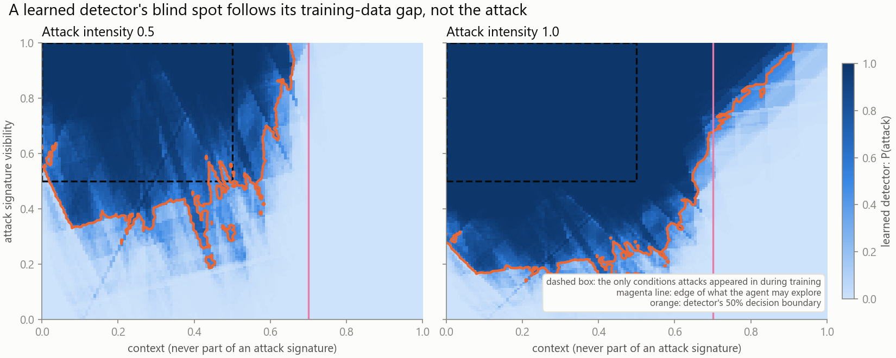</p>

The detector's blind spot follows its **training gap**, not the attack: a strong, fully visible attack is caught up to about 0.6 context and missed beyond about 0.7. The agent may only explore contexts up to 0.7; everything above is withheld (98% of it is a true blind spot, so that test is mostly "does the rule extrapolate to a region it never saw").

<p align="center">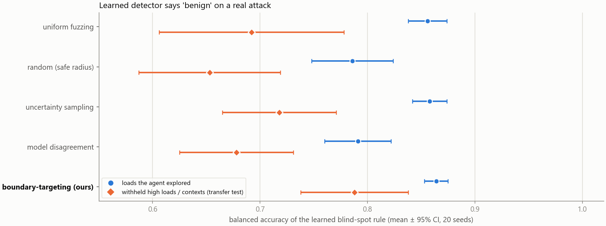</p>

**Blind-spot map (20 seeds, logistic rule, withheld contexts):** boundary-targeting **0.788 ± 0.050**, uncertainty sampling 0.718 ± 0.053, uniform fuzzing 0.692 ± 0.086, model disagreement 0.678 ± 0.053, random 0.653 ± 0.066. Boundary-targeting is best, but this is a smaller and noisier win than on the grid: its interval overlaps uncertainty sampling, so treat it as suggestive. On the contexts the agent did explore, all methods are close (0.79 to 0.86).

**Shortcut test (paired intervention):** hold a strong visible attack fixed and change *only* the context from low (0.1 to 0.4) to high (0.85 to 1.0). The detector's score on the attack drops by **0.73** (Wilcoxon p = 1.6e-11, n = 60), while its score on benign traffic moves by 0.12 (also significant, p = 6e-11, but about six times smaller). A detector that did not depend on context would show no change, so this flags context as a variable the model should not use.

<details><summary>Raw output</summary>
<p align="center">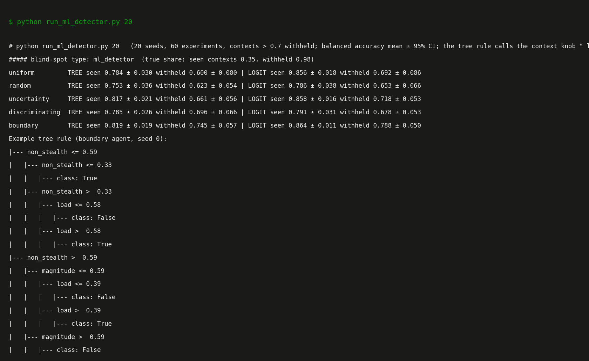</p>
</details>

**Why this matters, and what it does not show**
- It demonstrates the engine as an *audit tool for learned detectors*: it returns a readable map of where the detector fails and which non-causal variable it leans on, with evidence, using only black-box queries.
- The training gap and the shortcut are planted by me. This shows the engine can find a known kind of flaw in a learned detector, not that it will find unknown flaws in a deployed one.
- The tree rules in the saved output call the context knob `load` because the engine reuses the grid sandbox's input layout.
- Next steps for credibility: real public intrusion-detection datasets, several model families, and comparison with robustness-testing tools.

### How the agent works

| Step | Implementation |
|---|---|
| World model | ridge polynomial baseline fit on narrow historical data ([abd/agent.py](abd/agent.py)) |
| Competing explanations | committee of poly-1/2/3, random forest and Gaussian process; spread = knowledge boundary |
| Safe experiments | candidates restricted to a radius around already-tested points, plus a conservative predicted-output filter |
| Boundary extraction | shallow decision tree (readable rules) and a logistic rule with interaction features (extrapolates to unseen loads) |
| Blind-spot label | agent learns its own "no perturbation" reference from calibration runs, so it never needs ground truth ([abd/blindspot.py](abd/blindspot.py)) |
| Missing variable | residual of the x-only model vs candidate context channels, Bonferroni-corrected, then out-of-sample confirmation ([run_missing.py](run_missing.py)) |

Example rule found by the agent on one run (readable, not a black box):

```
non_stealth <= 0.06
|  magnitude <= 0.53              -> blind
|  magnitude  > 0.53
|     non_stealth <= 0.03         -> blind
|     non_stealth  > 0.03         -> detector responds
non_stealth > 0.06                -> detector responds
```

## Quickstart

```bash
git clone https://github.com/ara-5/Autonomous-Boundary-Discovery.git
cd Autonomous-Boundary-Discovery
pip install -r requirements.txt

python -m pytest -q                 # 3 smoke tests (~30 s)
python run_demo.py                  # stage 0: toy hidden-regime environment
python run_grid.py                  # stage 1: grid detector, prediction error
python run_blind.py 20              # stage 2: blind-spot map + withheld-load transfer (slow)
python run_missing.py 20            # stage 3: missing-variable discovery
python run_ml_detector.py 20        # stage 4: audit a learned (ML) detector + shortcut test
python scripts/make_media.py        # regenerate the GIFs and heatmap (needs PYTHONPATH=.)
python scripts/make_results.py      # regenerate the charts from results/*.txt
```

Verbatim outputs of the long runs are saved in [results/](results/).

## Repository layout

```
abd/
  env.py            toy environment with a planted hidden regime
  agent.py          committee world model, safe discriminating experiments, boundary + update
  grid_env.py       IEEE-14 grid + DC state estimator + bad-data detector
  grid_ctx_env.py   same, plus a hidden temperature driver and context channels
  blindspot.py      blind-spot agent, load withholding, adaptive-threshold labels
  ml_detector_env.py  learned (gradient-boosted) detector on synthetic traffic with a training gap
run_demo.py  run_grid.py  run_blind.py  run_missing.py  run_ml_detector.py
scripts/            make_media.py (GIFs, heatmap), make_results.py (charts)
results/            saved outputs of the 20-seed runs
tests/              smoke tests
```

## Limitations and prior art

I would rather state these up front than have them found.

**Limitations**
- Simulators only. The environments, the three-input parameterisation and the planted temperature driver are my construction.
- The agent's rule is imperfect: in the animation it underfits the diagonal tail of the true blind region.
- 20 seeds per cell; several differences have overlapping intervals (flagged above).
- The blind-spot definition (distinguishable by a margin, or below an adaptive threshold) is a modelling choice.
- Confirmation roughly doubles experiment cost; a cheaper sequential test is untested.

**Prior art this builds on or must be compared with** (from a first-pass search; I read snippets, not full papers, so treat as a reading list):
- Falsification of cyber-physical systems with Bayesian optimisation: [Ramezani et al.](https://research.chalmers.se/publication/546723)
- Safe Bayesian optimisation and safe-region classification: [SafeOpt-MC](https://arxiv.org/pdf/1602.04450), [GoSafe](https://arxiv.org/pdf/2105.13281.pdf), [Bottero et al.](https://pdf.arxiv.org/pdf/2402.15347)
- Hidden variables with active experiments: [LLM-AutoSciLab](https://huggingface.co/papers/2605.24043.md), [Model Discovery Agent](https://tldr.takara.ai/p/2608.09696)
- Learning-based detectors for stealthy false-data injection: [autoencoder detection](https://minds.wisc.edu/items/ef0b32bd-1840-4630-b443-b87891ca6e39), [deep learning on DER-rich grids](https://research.itu.edu.tr/en/publications/deep-neural-network-based-stealthy-false-data-injection-attack-de/)

Hidden-variable discovery with active experiments is already being pursued in general settings, so I am **not** claiming it as new. The open question this repo explores is the *combination*: boundary mapping plus missing-variable identification, under a safety constraint, verified on withheld conditions, applied to where a deployed defensive detector's model breaks.

## Roadmap

- Cheaper, sequential confirmation for the missing-variable step
- Baselines from the closest prior art (safe level-set sampling, BO falsification)
- Environments I did not design (larger grids, other domains, real public intrusion-detection datasets, several model families)
- Explicit hypothesis-based experiment selection (expected information gain) instead of committee disagreement
- A benchmark of procedurally generated hidden-rule environments

## License

Released under the [MIT License](LICENSE).

## Responsible use

This is a **defensive, simulation-only** project. The "perturbations" are synthetic measurement shifts inside a sandbox, used to find where a detector's model is unreliable so it can be hardened. It contains no tooling for real systems and none should be added.
